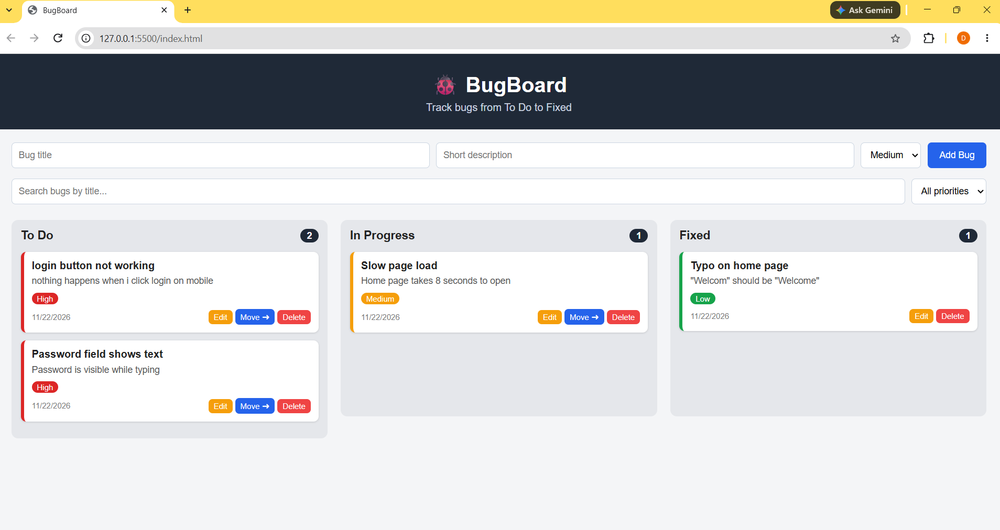

# 🐞 BugBoard

A Kanban-style bug tracking app where you can add bugs and move them from **To Do** to **In Progress** to **Fixed**.

**Live demo:** https://dhanusrinithyalakshmi.github.io/bugboard/

## Features

- Add bugs with a title, description, and priority (Low, Medium, High)
- Drag and drop cards between columns
- Move, edit, and delete bugs
- Search bugs by title
- Filter bugs by priority
- Live bug count in each column
- Data saved in the browser with localStorage
- Responsive layout for mobile

## Tech Stack

- HTML
- CSS
- JavaScript (DOM manipulation, localStorage, Drag and Drop API)

## How to Run

1. Clone the repository:
   `git clone https://github.com/dhanusrinithyalakshmi/bugboard.git`
2. Open the folder and double-click `index.html`

## Screenshots

## What I Learned

- Working with the DOM and event listeners
- Managing app state with arrays of objects
- Saving data with localStorage
- Using Git and GitHub

## Future Improvements

- Backend with Node.js and a database
- User login
- Comments on each bug